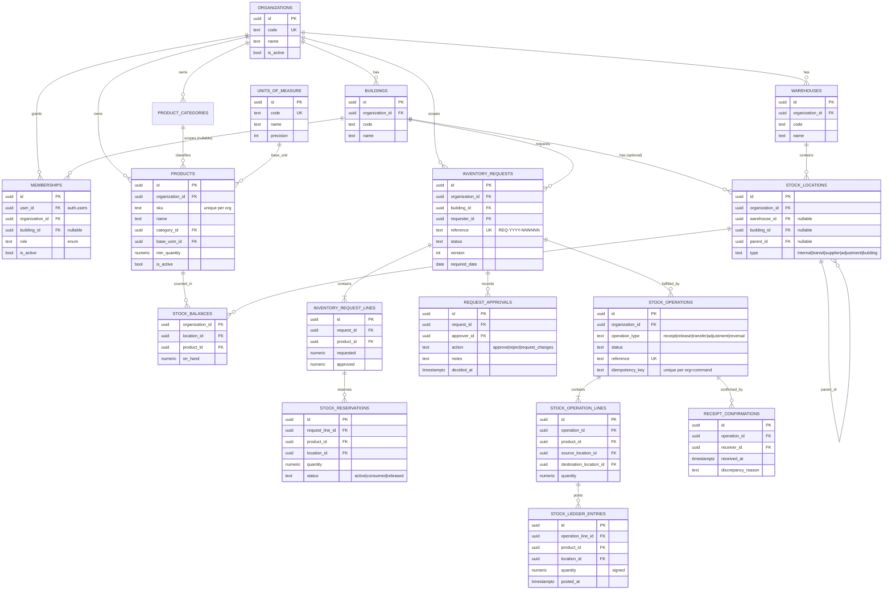

# Basic ERD (proposed)

**Status: Proposed** (Phase 0 exit gate). The source is `implementation.md` §5.1. Column lists show the key fields only. Every tenant-scoped table also carries `organization_id`, `created_at` and `updated_at`.

Also part of the model, but not drawn above: `user_profiles`, `attachments`, `audit_events` (append-only), `notifications`, and an organization-scoped `document_sequences` table for `REQ-`, `REL-` and `RCV-` numbering.
