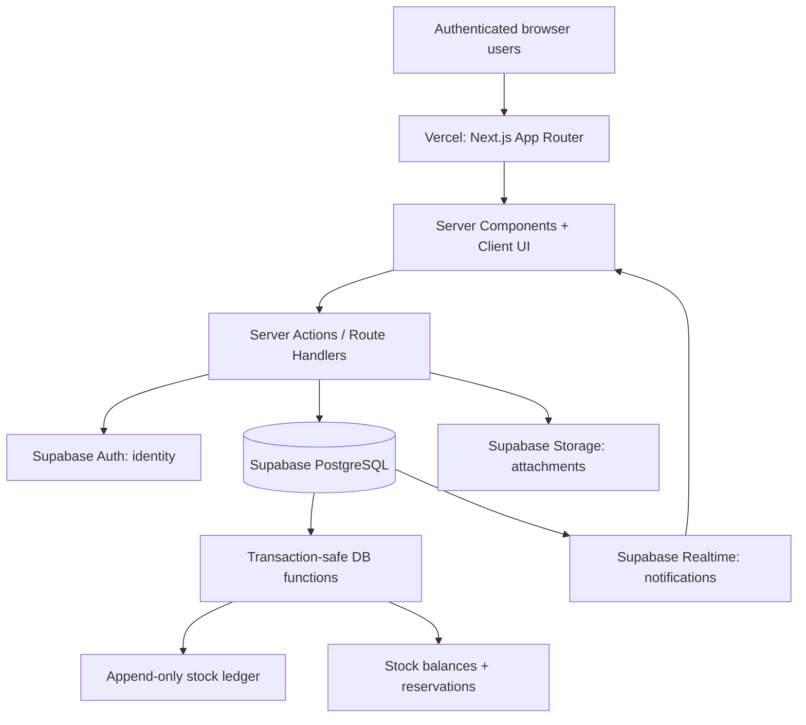
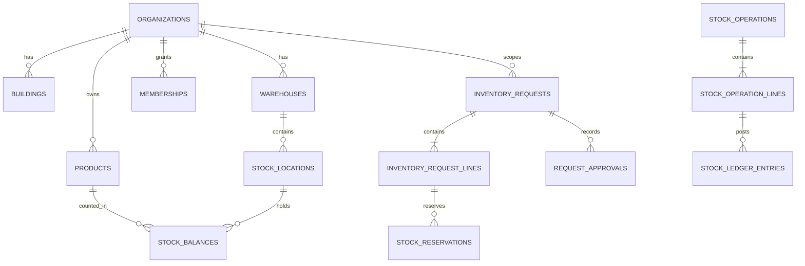
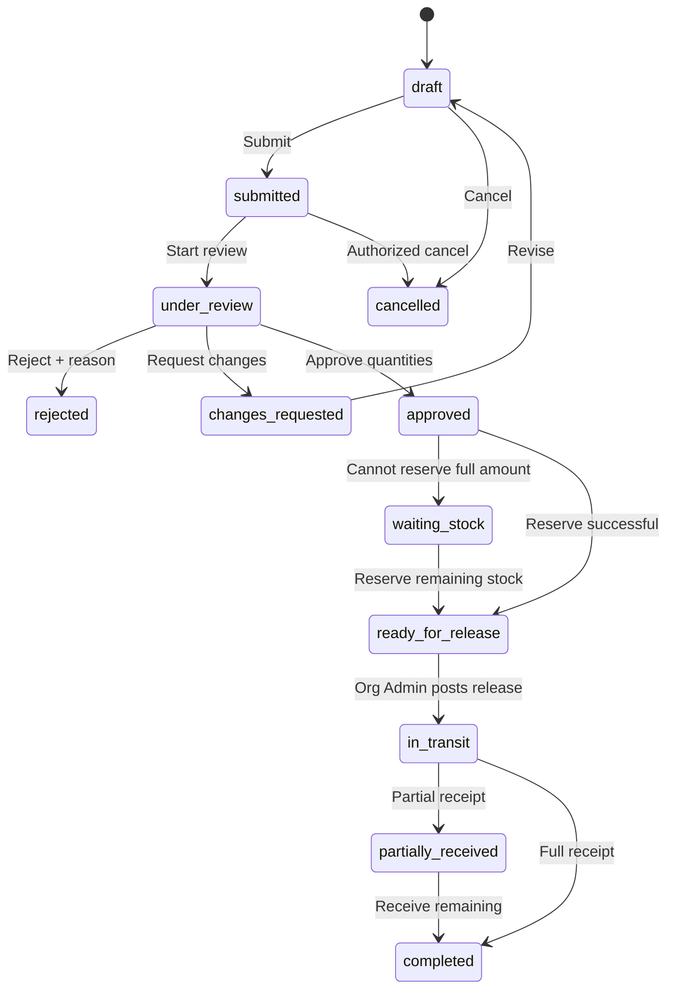

# InventoryOS — Implementation Guide

> **Document status:** Build-ready technical plan (v1.0)  
> **Updated:** 2026-11-18  
> **Product:** Odoo-inspired, multi-organization inventory management system  
> **Target stack:** Next.js App Router · TypeScript · Tailwind CSS · shadcn/ui · Supabase PostgreSQL/Auth/Storage/Realtime · Vercel  
> **Design reference:** `InventoryOS_UI_UX_Specification_v1.0.pdf`

---

## 0. How to use this document

This is the **implementation plan** for building InventoryOS. It translates the UI/UX specification into engineering workstreams, database contracts, security constraints, delivery gates, and tests. It is intended for developers and AI coding assistants working on the same repository.

**Instruction priority for implementation:**

1. Preserve inventory data correctness and security over visual fidelity or speed of delivery.
2. Preserve the business rule: **Building → Organization Admin review/approval → Organization Admin stock release → Requesting Building receipt.** No peer-to-peer building releases in v1.
3. Implement the reusable ERP shell and standard list/form components before cloning them across modules.
4. Never bypass PostgreSQL transactions for stock posting, or use frontend visibility as authorization.
5. Deliver one validated vertical slice at a time; do not scaffold all screens with dead buttons.

This guide contains proposed defaults; organizational policy decisions listed in [Open decisions](#18-open-decisions-before-production) must be resolved before go-live.

## 1. Scope and architecture

### 1.1 MVP included

- Auth, organization/building membership, permission-based navigation.
- Traditional ERP application shell, module menus, breadcrumbs, record toolbars.
- Products, product categories, stock units, warehouses, and stock locations.
- Immutable stock movement journal, on-hand and reserved balances.
- Supplier/external receipts, authorized issues, stock transfers, inventory adjustments.
- Building inventory requests, approvals, reservations, central-admin releases, destination receipt confirmation.
- Partial fulfillment, discrepancy documentation, attachment storage, audit trail.
- Inventory overview, stock-on-hand, movements, low-stock, request-aging reports.
- Server-side search, filters, sorting, grouping, pagination, and CSV exports.

### 1.2 Explicitly deferred from MVP

- Full accounting/GL integration and automated valuation posting.
- Manufacturing/MRP, sales orders, field service, and comprehensive purchasing.
- Barcode hardware integration, advanced lot/serial tracking, expiration/FEFO, and complex unit conversions.
- Complex configurable approval-flow designer; start with a centrally controlled, well-tested workflow.
- Offline-first operation and native mobile applications.
- Fully generic multi-tenant SaaS billing or tenant self-onboarding.

### 1.3 Architecture diagram



**Architecture rules:**

- One **modular monolith** repository/deployment, with features separated in folders.
- Read-oriented pages: Server Components; interactive grids/forms: Client Components.
- Server Actions: user-initiated mutations; Route Handlers: integrations, exports, webhooks.
- Sensitive mutations: permission-checked, schema-validated and executed via narrowly scoped PostgreSQL functions/transactions.
- PostgreSQL is the source of truth. Never compute or commit authoritative stock balances in the browser.
- Realtime is a convenience for notifications/refetch, **not** the transaction engine.

## 2. Technology and standards

| Layer | Choice | Implementation note |
|---|---|---|
| Framework | Next.js App Router | Follow the version's current route and request APIs |
| Language | TypeScript, strict mode | Avoid `any` in domain and database boundaries |
| UI | Tailwind CSS + shadcn/ui | Keep shared ERP design components in `components/erp` |
| Tables | TanStack Table | Controlled server-side paging, sorting, filtering |
| Forms | React Hook Form + Zod | Reuse schema on server, revalidate every mutation |
| Icons | Lucide | Accessible labels on icon-only actions |
| Database | Supabase PostgreSQL | SQL migrations + generated TypeScript database types |
| Identity | Supabase Auth + `@supabase/ssr` | SSR session cookies, verified claims, membership lookup |
| Files | Supabase Storage | Private buckets with access policies |
| Deployment | Vercel | Preview/staging/production separation |
| Unit tests | Vitest | Permissions, schemas, state machine, formatting |
| Browser tests | Playwright | Role workflows, table navigation, failure states |
| DB tests | Supabase CLI + SQL/pgTAP | RLS, posting invariants, concurrency |
| Observability | Structured logs + error tracking | Redact personal data, tokens and secrets |

**Version policy:** At project initialization, select versions supported by current official documentation, commit the lockfile, and record the tested Node.js version. Do not blindly pin framework/library versions from an old tutorial.

## 3. Local setup

### 3.1 Requirements

- Current supported Node.js LTS and npm.
- Git and GitHub repository access.
- Supabase project(s), Supabase CLI and local Docker runtime if developing against local Supabase.
- Vercel project for staging/production deployments.
- Secure secret management; do not commit `.env.local` or database credentials.

### 3.2 Bootstrap

```bash
npx create-next-app@latest inventoryos -e with-supabase
cd inventoryos

npx shadcn@latest init
npx shadcn@latest add button badge breadcrumb card checkbox command dialog dropdown-menu input label navigation-menu popover select separator sheet skeleton sonner table tabs textarea tooltip alert-dialog

npm install @tanstack/react-table react-hook-form zod @hookform/resolvers lucide-react
npm install -D vitest @testing-library/react @testing-library/jest-dom @playwright/test
```

> The Supabase Next.js starter and shadcn CLI can change. Validate the scaffold and component registry commands against their documentation at bootstrap time. Install only components actually used.

### 3.3 Environment variables

Create `.env.local` (never commit real values):

```dotenv
NEXT_PUBLIC_SUPABASE_URL=https://YOUR_PROJECT.supabase.co
NEXT_PUBLIC_SUPABASE_PUBLISHABLE_KEY=YOUR_SUPABASE_PUBLISHABLE_KEY
```

Use `@supabase/ssr` server/browser clients. In modern Next.js releases, configure the framework's supported request **Proxy** for session refresh; older releases may use middleware. Server-side access decisions must use authenticated, verified identity (`auth.getClaims()` or a verified user lookup where appropriate), **not** untrusted data from `getSession()`.

Keep Supabase secret/service-role credentials confined to approved backend-only processes, and avoid them in normal user-request paths.

### 3.4 Standard scripts and quality gates

Configure package scripts for `dev`, `build`, `lint`, `typecheck`, `test`, and `test:e2e`. Before merging, require all of these that apply:

```bash
npm run lint
npm run typecheck
npm run test
npm run build
```

Migrations should be developed locally, reviewed, and applied through CI/CD or a documented release procedure—never silently edited directly in the production dashboard.

## 4. Repository structure

```text
inventoryos/
├── src/
│   ├── app/
│   │   ├── (auth)/login/page.tsx
│   │   ├── (erp)/layout.tsx
│   │   ├── (erp)/inventory/
│   │   │   ├── overview/page.tsx
│   │   │   ├── products/page.tsx
│   │   │   ├── products/[productId]/page.tsx
│   │   │   ├── requests/page.tsx
│   │   │   ├── requests/[requestId]/page.tsx
│   │   │   ├── requests/approvals/page.tsx
│   │   │   ├── operations/receipts/
│   │   │   ├── operations/releases/
│   │   │   ├── operations/transfers/
│   │   │   ├── operations/counts/
│   │   │   ├── operations/adjustments/
│   │   │   ├── reports/
│   │   │   └── configuration/
│   │   └── api/exports/route.ts
│   ├── components/
│   │   ├── ui/                   # shadcn primitives
│   │   └── erp/                  # shared ERP patterns
│   │       ├── app-shell/
│   │       ├── control-panel/
│   │       ├── data-table/
│   │       ├── record-form/
│   │       ├── status-bar/
│   │       ├── smart-buttons/
│   │       └── activity/
│   ├── features/
│   │   ├── organizations/
│   │   ├── products/
│   │   ├── inventory/
│   │   ├── requests/
│   │   ├── approvals/
│   │   ├── operations/
│   │   ├── reporting/
│   │   └── auditing/
│   ├── lib/
│   │   ├── supabase/{client,server}.ts
│   │   ├── authorization/
│   │   ├── validation/
│   │   └── utils/
│   └── types/database.types.ts
├── supabase/
│   ├── migrations/
│   ├── seed.sql
│   └── tests/
├── tests/e2e/
├── public/
├── .env.example
├── implementation.md
└── README.md
```

**Module convention:** each feature owns its types, Zod schemas, read queries, server commands, and UI containers. Share only stable primitives and domain abstractions.

## 5. Core database model

### 5.1 Entity catalog

| Table | Responsibility | Key fields / constraints |
|---|---|---|
| `organizations` | Tenant/business scope | `id`, `code`, `name`, `is_active` |
| `buildings` | Requesting/destination sites | `id`, `organization_id`, `name` |
| `user_profiles` | User display metadata | `user_id` FK to `auth.users` |
| `memberships` | Org/building role assignment | `user_id`, `organization_id`, `building_id` nullable, `role`, `is_active` |
| `warehouses` | Main supply points | `organization_id`, `code`, `name` |
| `stock_locations` | Physical, transit, virtual locations | `organization_id`, `warehouse_id` nullable, `building_id` nullable, `parent_id` nullable, `type` |
| `product_categories` | Product catalog hierarchy | `organization_id`, `name`, `parent_id` |
| `units_of_measure` | Canonical stock units | `code`, `name`, `precision` |
| `products` | Stockable product master | `organization_id`, `sku`, `name`, `category_id`, `base_uom_id`, `is_active` |
| `stock_balances` | Materialized current quantity by location | unique (`organization_id`,`location_id`,`product_id`, optional lot dimension) |
| `stock_reservations` | Quantity reserved for approved requests | request-line FK, product, location, `quantity`, lifecycle status |
| `stock_operations` | Business transaction header | `organization_id`, `operation_type`, `status`, `reference`, `idempotency_key` |
| `stock_operation_lines` | Transaction products/quantities | `operation_id`, product, source, destination, quantity |
| `stock_ledger_entries` | Immutable posted movement records | `operation_line_id`, product, location, signed quantity, posted timestamp |
| `inventory_requests` | Request header | org, building, requester, state, reference, dates |
| `inventory_request_lines` | Requested/approved/fulfilled line quantities | request FK, product, requested/approved quantities |
| `request_approvals` | Approval decisions and reasons | request FK, approver, action, timestamp, notes |
| `receipt_confirmations` | Destination-receipt acknowledgments | operation FK, receiver, timestamp, discrepancy reason |
| `attachments` | Storage object metadata | org, linked document type/id, bucket/path |
| `audit_events` | Append-only who/what/when record | actor, entity, action, before/after metadata |
| `notifications` | In-app user activity | org, user, type, entity, `read_at` |

**Additional constraints:**

- All tenant-scoped data must include `organization_id` and enforce consistent org membership in foreign-key relationships and/or transaction validation.
- Use generated UUID primary keys (or a consistent alternative), `created_at`, `updated_at` where relevant, and explicit unique business keys.
- SKU should be unique **per organization** if organizations own separate catalogs; global catalog sharing is a separate design decision.
- `quantity` uses PostgreSQL `numeric` with validated positive inputs and product-specific precision—not floating-point.
- Use UTC-capable `timestamptz`; format display in `Asia/Manila` by default.
- Store stock in canonical units, with a defined conversion layer if alternate units are enabled.
- Don't store a free-form editable `products.quantity`; stock comes from the stock domain.

### 5.2 Relationship overview



### 5.3 Stock ledger semantics

**Definitions:**

- `on_hand`: posted stock currently at a physical location.
- `reserved`: unfulfilled allocation against approved requests.
- `available`: `on_hand - reserved`; must not become negative except via an explicitly approved, documented exception policy.
- `in_transit`: quantity in a designated transit location, not counted as physically available at origin or destination.

Every posted stock operation creates **immutable, balanced location movements** (for example, `-5` at origin and `+5` at destination or a defined external/virtual location). The journal and the balance projection are updated **in the same DB transaction**. Direct client `UPDATE stock_balances` access is forbidden.

### 5.4 Posting algorithm (specification, not copy-paste SQL)

For a release/receipt/transfer/adjustment transaction:

1. Accept document ID, command, intended version/state, and unique idempotency key.
2. Authenticate actor; load membership and authorize the exact organization, location and command.
3. Start one database transaction, check the document state and expected version.
4. Lock relevant stock balance rows (`SELECT ... FOR UPDATE`) in deterministic order; create/lock absent balances safely under unique constraints.
5. Check approved/unfulfilled quantities and available stock where required.
6. Update/release reservations as appropriate to the operation.
7. Append journal entries with source and destination legs; atomically update balance projections.
8. Set the operation status, linked document quantities, audit event and idempotency result.
9. Commit; otherwise rollback **all** changes.
10. Return the canonical updated state for UI revalidation.

Protect against duplicate network retries with a unique key per organization and command scope. A unique operation reference alone is not enough for idempotency.

> **Important:** PostgreSQL functions are executed transactionally when called as an RPC; do not divide one stock posting across several independent Supabase client requests. Restrict database function `EXECUTE` privileges and review any `SECURITY DEFINER` function's search path, object references, and authorization checks.

### 5.5 Document numbering

Use a database-backed, organization-scoped counter to allocate unique numbers, e.g. `REQ-2026-000001`, `REL-2026-000001`, `RCV-2026-000001`. Allocate on creation or submission per documented policy. Never use client-side `count + 1`.

## 6. Authorization and audit controls

### 6.1 Role definitions

- `platform_admin`: Platform configuration only; **not** automatic stock approval power.
- `org_admin`: Approves/rejects, authorizes releases/adjustments and sees scoped org reports.
- `warehouse_staff`: May prepare picking/receipts/counts; no final release authorization in v1.
- `building_manager`: Creates and tracks requests for assigned buildings; may confirm destination receipts when assigned.
- `requester`: Creates and views assigned building requests; may be designated receiver only when separately permitted.
- `viewer`: Read-only scoped catalog/stock access.
- `auditor`: Read-only movements, controls and reports within scope.

### 6.2 Authorization design

- Authentication ≠ permission. Validate every Server Action and Route Handler independently.
- RLS policies limit read/write visibility by `auth.uid()` and active memberships.
- A user's role assignment must be valid for the **record's organization** and, where relevant, **building/warehouse**.
- Do not trust organization IDs, roles, release quantities or `approved_by` supplied by the browser.
- Use explicit domain commands for privileged transitions (e.g., `approve_request`, `post_release`); disallow generic client writes to approved documents, journal entries, balances, and audit records.
- A DB RPC that bypasses RLS is not automatically secure; perform actor/membership checks in the function itself, revoke broad execute rights, and test role abuse.
- Private Storage policies must restrict attachments to authorized org/record viewers; don't expose public bucket paths for sensitive files.

### 6.3 Permission matrix (MVP defaults)

| Action | Org Admin | Warehouse Staff | Building Manager | Requester | Viewer/Auditor |
|---|:---:|:---:|:---:|:---:|:---:|
| View scoped products | ✓ | ✓ | ✓ | ✓ | ✓ |
| Create request | ✓ | By policy | ✓ | ✓ | — |
| Submit own/assigned request | ✓ | By policy | ✓ | ✓ | — |
| Approve/reject | ✓ | — | — | — | — |
| Prepare pick/release record | ✓ | ✓ | — | — | — |
| Post stock release | ✓ | — | — | — | — |
| Confirm receipt at assigned building | If assigned | If assigned | ✓ | If assigned | — |
| Post stock adjustment | ✓ | — | — | — | — |
| Inspect audit trail | ✓ | Limited | Limited | Own | Auditor only |
| Configure roles/workflows | Authorized admins | — | — | — | — |

**Audit events to capture:** actor, timestamp, organization, entity type/id, command, previous/new state, relevant quantity changes, correlation/idempotency key and reason. Maintain append-only records and a defined retention policy.

## 7. Workflow contracts

### 7.1 Inventory request lifecycle



**UI state bar** shows the user-facing stages; backend may maintain a separate fulfillment status to accurately represent partial reservations/partial releases and multiple delivery documents. Do not encode all line-level inventory truth into a single header enum.

### 7.2 Required workflow transitions

| Command | Actor | Preconditions | Atomic result |
|---|---|---|---|
| `submit_request` | Requester / Building Manager | Valid draft, >=1 item, assigned building | Submitted request + audit |
| `approve_request` | Org Admin | Submitted/in review, valid approved quantities | Approval event + approved lines |
| `reject_request` | Org Admin | Pending review, reason provided | Rejected + decision event |
| `reserve_stock` | Authorized server/DB command | Approved quantity, supply location, availability | Reservation + updated available |
| `post_release` | Org Admin | Valid approval/reservation/pick quantities | Posted origin-to-transit movement + release event |
| `confirm_receipt` | Authorized receiving actor | Linked posted release; outstanding quantity | Transit-to-destination movement + receipt record |
| `post_adjustment` | Org Admin | Approved count/adjustment and reason | Posted adjustment + audit |
| `reverse_posting` | Privileged corrector | Posted source transaction, reason | Compensating movement, never mutation of history |

**Non-negotiable rules:**

1. A building cannot issue inventory directly to a peer building in v1.
2. Approving a request does **not** release stock.
3. Releasing stock does **not** automatically confirm receipt.
4. A partial receipt cannot exceed remaining released quantity.
5. Edited approved quantities must be auditable and revalidated; stale approval decisions cannot silently apply to changed requests.
6. A completed/posted operation is read-only and corrected only by linked follow-up postings.
7. All commands must remain safe under concurrency, retries, and abandoned browser sessions.

## 8. UI design-system implementation

### 8.1 Core design tokens

Maintain tokens in CSS variables (and Tailwind theme mapping) rather than hardcoded colors inside components.

```css
:root {
  --erp-brand: #65445f;
  --erp-brand-hover: #50354b;
  --erp-accent: #806178;
  --erp-canvas: #f7f8fa;
  --erp-surface: #ffffff;
  --erp-surface-muted: #f1f3f6;
  --erp-text: #1d2939;
  --erp-text-muted: #667085;
  --erp-border: #dde2e8;
  --erp-success: #18794e;
  --erp-warning: #a65c00;
  --erp-danger: #b42318;
  --erp-info: #175cd3;
}
```

**Density:** 52px global header; 42px module bar; 40–44px table rows; 36px inputs/buttons on desktop; touch-accessible dimensions on small screens. Typography: Inter/Geist, body/data 14px, small metadata 12–13px. Provide readable zoom and WCAG 2.2 AA focus/contrast behavior.

### 8.2 Reusable ERP components, in recommended build order

1. `ERPAppShell`: global app launcher, org selector, notifications, profile, horizontal navigation.
2. `ERPPageHeader`: breadcrumbs, title, primary/secondary action slots.
3. `ERPControlPanel`: keyword search, filter chips, Filters/Group By/Favorites menus, list/kanban switch.
4. `ERPDataTable<T>`: controlled URL query state, selection, columns, server paging and bulk action slots.
5. `RecordForm`: save/discard, metadata, read-only state and field/error layout.
6. `RecordStatusBar`: allowed status transitions and stage history.
7. `SmartButton`, `RelatedRecordPicker`, `EditableLineItems`, `ActivityTimeline`.
8. `ConfirmActionDialog`, `AttachmentField`, `AuditHistoryPanel`, `EmptyState`, `ErrorState`, `Skeletons`.

### 8.3 Page layout patterns

**List page**

```text
ERP header
Module menu
Breadcrumb › Section › List title
[New] [Actions...]                  [List] [Kanban]
[Search] [Filters] [Group By] [Favorites]
┌──────────────────────────────────────────────────┐
│ □  Ref  Building  Date  Items  Assignee  Status  │
│ □  ...                                           │
└──────────────────────────────────────────────────┘
Selected: N                         1–50 of 300 < >
```

**Record page**

```text
Breadcrumb > REQ-2026-000123
[Save / Submit / Approve / Release]  [Other actions]
Reference + organization + building      [Status bar]
Smart buttons: [Movement 2] [Documents 3] [Audit]
[Products] [Approvals] [Fulfillment] [Attachments]
Embedded line-items grid
Activity timeline + comments
```

### 8.4 Table specification

- Fields selectable with column visibility, sorting, and sticky headers.
- URL-backed search, filters, grouping, sorting and pagination; restore context after returning from detail.
- Prefilters: My Requests, Pending Approval, Ready for Release, Awaiting Receipt, Low Stock.
- Pagination default: 50 rows; clamp/max page size on server.
- All data queries scoped by organization + permission; exports repeat the same checks.
- Inline edit permitted only for explicitly authorized draft fields; never for posted stock.
- Responsive: reduced columns and compact cards on mobile.

## 9. Route-by-route implementation

| Route | MVP capability | Permissions / dependencies |
|---|---|---|
| `/inventory/overview` | Operations counts, tasks, alerts | Scoped aggregate queries |
| `/inventory/products` | Product list, search/filter, import later | `products:read` |
| `/inventory/products/[productId]` | Tabs: general, inventory, locations, history, files | `products:read`; edit according to permission |
| `/inventory/requests` | My/all requests, preset filters | Request scope and status |
| `/inventory/requests/[requestId]` | Editable draft, detail tabs, timeline, state commands | State + ownership + role |
| `/inventory/requests/approvals` | Admin approval queue with decisions | `requests:approve` |
| `/inventory/operations/releases` | Authorized release queue | `releases:prepare` / `releases:post` |
| `/inventory/operations/receipts` | Incoming receipt queue and actual quantities | `receipts:confirm` and destination scope |
| `/inventory/operations/transfers` | Controlled movement forms | Location operation permissions |
| `/inventory/operations/counts` | Cycle count records | Counting permissions |
| `/inventory/operations/adjustments` | Variance approval/posting | Org Admin post permission |
| `/inventory/reports` | Stock/usage/history reports | Scoped report rights |
| `/inventory/configuration` | Organizations, locations, users, workflow settings | Configuration permissions |

**Page completion contract:** loading and empty states, permission-denied state, responsive layout, keyboard navigation, accessible labels, deep-linking, data refresh after mutation, audit visibility and tests.

## 10. Server command boundaries

Define explicit domain commands rather than sending arbitrary record updates.

```ts
// Shape illustration — implementation signatures are validated on server.
type RequestCommand =
  | { type: "submit_request"; requestId: string; expectedVersion: number }
  | { type: "approve_request"; requestId: string; approvedLines: Array<{ lineId: string; quantity: string }>; expectedVersion: number }
  | { type: "reject_request"; requestId: string; reason: string; expectedVersion: number }
  | { type: "post_release"; releaseId: string; idempotencyKey: string; expectedVersion: number }
  | { type: "confirm_receipt"; receiptId: string; receivedLines: Array<{ lineId: string; quantity: string }>; idempotencyKey: string };
```

For each command:

1. Parse with Zod; reject unknown/unexpected fields.
2. Resolve verified identity and organization membership on server.
3. Enforce authorization and current state (not merely what the UI displayed).
4. Call a narrow database RPC/transaction.
5. Map domain errors to safe, actionable user messages (`INSUFFICIENT_STOCK`, `STATE_CONFLICT`, `FORBIDDEN`, `DUPLICATE_COMMAND`).
6. Revalidate affected pages/tags and return canonical updated status.
7. Log the event with a correlation ID and no credentials/secret data.

**Examples of client-facing feedback:**

- “Available stock changed. Review the updated quantity before releasing.”
- “This request has already been approved by another user.”
- “You don't have permission to release stock for this organization.”
- “Receipt quantity cannot exceed the remaining released quantity.”

## 11. Reporting and search

### 11.1 Initial reports

- Stock on hand, reserved, available and in transit by warehouse/location.
- Chronological stock movement by product/location/operation.
- Building consumption for a date range.
- Low-stock products by configured threshold.
- Pending requests by age, building, approver and status.
- Adjustments and discrepancies by date and actor.
- Audit timeline filtered by entity or user.

### 11.2 Implementation rules

- Use indexed, tenant-scoped SQL queries or views; avoid unbounded client-side filtering.
- Large exports should stream, page, or use background generation when necessary.
- Show `As of` timestamp and explicit organization/location scope.
- Restrict export columns as carefully as on-screen columns.
- Do not present stock valuation as correct until costing method, currency and accounting policy are implemented and validated.

## 12. Testing and acceptance criteria

### 12.1 Unit and component tests

- Zod validation, quantity rounding, request state transition rules.
- Permission matrix across roles and scope.
- ERP table URL state and selection behavior.
- Required form fields, error messages and dirty state.
- Visibility and explanation of forbidden actions.

### 12.2 Database integration/security tests

- Cross-organization queries rejected by RLS.
- Unassigned building cannot read/receive another building's stock documents.
- Requester cannot approve by calling an RPC directly.
- Warehouse staff cannot post releases in v1.
- Concurrent releases do not oversell; only valid reservation/stock amounts post.
- Duplicate idempotency key returns same result; no repeated ledger entries.
- Partial transaction failure leaves balances, ledger and statuses unchanged.
- Partial receipts and subsequent receipts reconcile with released total.
- Reversal creates compensating entries, never edits original ledger.
- Unauthenticated and revoked users denied.

### 12.3 End-to-end scenario

```text
Requester creates draft
→ Submits to Organization Admin
→ Admin reviews and approves selected quantities
→ System reserves available stock (or marks waiting)
→ Admin prepares/validates release
→ Admin posts release; origin decreases, transit increases
→ Building receiver confirms actual quantities
→ Transit decreases, destination increases
→ Document reaches completed state when fully fulfilled
→ Audit and stock movement reports reconcile
```

**Negative tests:** unauthorized approvals, stale form version, duplicate click, insufficient stock, two users posting together, partial delivery, damaged goods, wrong organization, inaccessible attachment, browser refresh mid-posting.

### 12.4 Nonfunctional targets (initial)

- Accessible at WCAG 2.2 AA for core workflows.
- Desktop-first layout and functional mobile request/receipt workflows.
- Representative test datasets: 10,000+ products, 100,000+ movements, 50–100 concurrent active users (revisit actual operational load).
- Define query/performance budgets after baseline load tests rather than asserting unmeasured response times.
- Backups, recovery drill and monitoring are required before production.

## 13. Release phases and detailed deliverables

### Phase 0 — Foundation and decisions

- [ ] Confirm organization/building/location hierarchy.
- [ ] Confirm authorization and approval policy.
- [ ] Confirm product catalog scope and units of measure.
- [ ] Create GitHub repository, environments and migration strategy.
- [ ] Record architecture decisions (ADRs) for stock ledger and authorization.

**Exit gate:** approved basic ERD and written inventory invariants.

### Phase 1 — ERP design system and shell

- [ ] Next.js scaffold, shadcn setup, CSS tokens, app shell.
- [ ] Global header, module navigation, organization selector, breadcrumbs.
- [ ] Reusable list view, filters, saved search UI, table action toolbar.
- [ ] Reusable record form, tabs, status bar, smart buttons, timeline placeholders.
- [ ] Responsive and accessibility baseline.
- [ ] Playwright smoke tests for navigation and sample screens.

**Exit gate:** realistic clickable product/request list and detail screens with mock data, no misleading functional claims.

### Phase 2 — Authentication, organizations and access control

- [ ] Supabase SSR authentication and protected routes.
- [ ] Profile, memberships, organizations, buildings and warehouses.
- [ ] Scoped navigation and server authorization helpers.
- [ ] Initial SQL migrations and RLS policies.
- [ ] Role-policy tests (including direct API/RPC attacks).

**Exit gate:** cross-org access denied in browser, server actions and database.

### Phase 3 — Product catalog and locations

- [ ] Products, categories, units, attachments, active/archive status.
- [ ] Warehouse and stock location CRUD with hierarchy validation.
- [ ] Product list/detail connected to real Supabase data.
- [ ] SKU uniqueness and input validation.
- [ ] Database query pagination/filter indexes.

**Exit gate:** staff can manage scoped products and locations reliably.

### Phase 4 — Stock accounting engine

- [ ] Ledger, balances, reservation schema and posting RPCs.
- [ ] External receipts and internal transfers.
- [ ] Inventory counts and approved adjustments.
- [ ] Reversal and idempotency support.
- [ ] SQL concurrency and rollback tests.

**Exit gate:** reconciliation of ledger to balances passes; overselling and double posting blocked.

### Phase 5 — Requests, approvals, releases and receipts

- [ ] Request creation, line items and status progression.
- [ ] Admin approval/rejection with comments/quantity overrides.
- [ ] Reservation and waiting-for-stock handling.
- [ ] Admin-only release, in-transit balances and destination receipts.
- [ ] Partial fulfillment, discrepancies, attachments and notifications.
- [ ] Full E2E roles-based scenario and negative tests.

**Exit gate:** end-to-end Building → Org Admin → Building workflow works and cannot be bypassed.

### Phase 6 — Reports, production hardening and launch

- [ ] Dashboards, stock reports, request aging, audit views, exports.
- [ ] Performance profiling and indexes for representative dataset.
- [ ] Accessibility review, error monitoring, notification reliability.
- [ ] Migration/rollback rehearsal, backup and restore test.
- [ ] UAT with Org Admin, warehouse staff, building manager, requester and auditor.
- [ ] Deployment checklist, operational handbook and support process.

**Exit gate:** approved UAT and production readiness sign-off.

## 14. Suggested ticket breakdown / initial backlog

| ID | Ticket | Depends on | Definition of done |
|---|---|---|---|
| UI-001 | Implement `ERPAppShell` | Phase 1 setup | Header/module nav responsive, accessible |
| UI-002 | Implement `ERPDataTable` | UI-001 | Server pagination, sorts, filters, URL state |
| UI-003 | Implement `RecordForm` + tabs | UI-001 | Validation and unsaved changes supported |
| UI-004 | Implement `RecordStatusBar` | UI-003 | Current/past stages and allowed commands displayed |
| SEC-001 | Auth SSR and protection | Scaffold | Session handling and verified identity |
| SEC-002 | Memberships and RLS | SEC-001 | Unauthorized org/building access denied |
| CAT-001 | Catalog migration | SEC-002 | Constraints, product CRUD, tests |
| LOC-001 | Locations migration | SEC-002 | Hierarchy and scoped CRUD |
| STK-001 | Ledger + balances | CAT-001, LOC-001 | Posting/rollback/reconciliation tests |
| STK-002 | Reservations | STK-001 | No over-reservation under concurrency |
| REQ-001 | Requests UI and data | CAT-001, SEC-002 | Create, edit, submit, cancel drafts |
| APR-001 | Org Admin approval | REQ-001 | Approval permissions and audit history |
| REL-001 | Authorized release | STK-002, APR-001 | Atomic origin→transit posting |
| RCV-001 | Destination receipt | REL-001 | Partial/full transit→destination posting |
| REP-001 | Operational reports | STK-001, REQ-001 | Reconciled scoped views and CSV exports |
| OPS-001 | CI, logging, backups, UAT | All | Production readiness criteria pass |

Tickets should be further split into testable PR-sized tasks. Do not mark a ticket complete merely because a mock screen renders.

## 15. Deployment: Supabase + Vercel

### 15.1 Environments

| Environment | Purpose | Database |
|---|---|---|
| Local | Feature development and migrations | Local Supabase when practical |
| Preview | PR interface review | Isolated staging/test data; no production secrets |
| Staging | Full integration, UAT, migration rehearsal | Separate Supabase staging project |
| Production | Real inventory operation | Separate Supabase production project |

**Deploy sequence:**

1. Review/merge code and SQL migrations; ensure migrations are backward-compatible where possible.
2. Apply migrations to staging, regenerate DB types, and run DB tests.
3. Deploy staging Vercel build; run Playwright and complete role-based UAT.
4. Confirm production backup/recovery point and approved release window.
5. Apply production schema changes using controlled credentials.
6. Deploy Vercel production build; perform smoke tests on read and safe write paths.
7. Monitor errors, queue/notification health, stock ledger integrity and response times.

### 15.2 Deployment safeguards

- Set separate Vercel environment variables for each stage.
- Never attach a preview deployment to the production Supabase database.
- Define migration rollback/forward-fix policy. Destructive changes require careful staged migration.
- Set up daily database backups according to Supabase plan/capabilities and confirm actual recovery procedures.
- Establish secrets rotation and least privilege for CI jobs.
- Verify hostname, TLS, auth redirect URLs, CORS/integration origins and storage policies.
- Add database consistency checks and alert on stock projection vs ledger drift.

## 16. Engineering conventions and pull requests

- TypeScript strict; `eslint` and formatting enforced.
- SQL migrations are incremental, reviewed and immutable after production application.
- User-visible business states use centrally defined enums/labels; do not duplicate strings across pages.
- All date/time calculations use explicit timezone rules.
- All commands produce consistent typed success/error results.
- Domain events/audit are created server-side, never supplied as trusted browser payloads.
- Feature PRs include: screen demo/screenshot, schema changes, RLS review, tests, accessibility notes, and migration considerations.
- Never log access tokens, passwords, Supabase secrets or full sensitive attachments.

### PR template checklist

- [ ] Feature follows matching routes/layout and shared ERP components.
- [ ] Client input is validated again server-side.
- [ ] Role + org/building/location authorization verified.
- [ ] RLS and database grants reviewed if schema changed.
- [ ] Stock movement is transactional/idempotent if applicable.
- [ ] Audit events and human-readable errors added.
- [ ] Tests include negative and concurrent behavior as applicable.
- [ ] Empty/loading/error/forbidden states present.
- [ ] No production secrets in code, logs, test data or screenshots.

## 17. Definition of done (MVP)

Production MVP is ready only when:

- [ ] All required navigation, product, warehouse, request, approval, release, receipt and report pages function against real data.
- [ ] Every role sees only permitted organization/building information.
- [ ] Org Admin is the sole final approver/releaser in the initial business process.
- [ ] No direct building-to-building release bypass exists.
- [ ] Stock ledger reconciles to on-hand, reserved and in-transit projections.
- [ ] Over-issuance, duplicate posting and partial transaction commits are prevented and tested.
- [ ] Partial receipts, returns/corrections and document links are traceable.
- [ ] Critical actions are auditable with actor and timestamp.
- [ ] Performance and accessibility pass agreed UAT criteria.
- [ ] Staging and production environments are isolated, tested, monitored and recoverable.

## 18. Open decisions before production

Resolve and document these while implementing; use conservative defaults until approved:

1. **Product catalogs:** separate per organization vs shared company catalog?
2. **Supply topology:** one central warehouse per organization vs multiple authorized supply warehouses?
3. **Location structure:** whether each building has tracked on-hand stock and its own sublocations.
4. **Units:** base units only at launch or packages/boxes-to-pieces conversions?
5. **Reservations:** partial reservation allowed, and whether shortages auto-retry when new stock arrives?
6. **Approvals:** any quantity threshold or mandatory second approver, or sole Org Admin approval?
7. **Discrepancies:** who resolves damaged/short/over-delivered stock and who authorizes returns?
8. **Adjustments:** policy on negative adjustments, variance thresholds, reason codes and count signoff.
9. **Valuation:** whether to track cost now; if so FIFO, average cost or another approved accounting method.
10. **Notifications:** in-app only or email; SLA/escalation requirements.
11. **Imports:** initial product/stock master data quality and opening-balance signoff.
12. **Retention:** audit, attachment and backup retention requirements.

## 19. Official references

Use current vendor documentation when implementing version-specific APIs:

- [Next.js — Authentication](https://nextjs.org/docs/app/guides/authentication)
- [Next.js — Data Security](https://nextjs.org/docs/app/guides/data-security)
- [Supabase — SSR Auth](https://supabase.com/docs/guides/auth/server-side)
- [Supabase — Creating a Next.js server/browser client](https://supabase.com/docs/guides/auth/server-side/creating-a-client?framework=nextjs)
- [Supabase — Row Level Security](https://supabase.com/docs/guides/database/postgres/row-level-security)
- [Supabase — Database Functions](https://supabase.com/docs/guides/database/functions)
- [Supabase — Securing Your API](https://supabase.com/docs/guides/api/securing-your-api)
- [shadcn/ui — Data Table](https://ui.shadcn.com/docs/components/radix/data-table)
- [Vercel — Documentation](https://vercel.com/docs)

---

**First implementation target:** Finish Phase 1 (`ERPAppShell` → `ERPDataTable` → `RecordForm` → `RecordStatusBar`) using mock data, then complete Phase 2 authentication/authorization before wiring privileged inventory actions. Treat stock-ledger safety and the Org Admin approval/release rule as release blockers, not optional enhancements.
